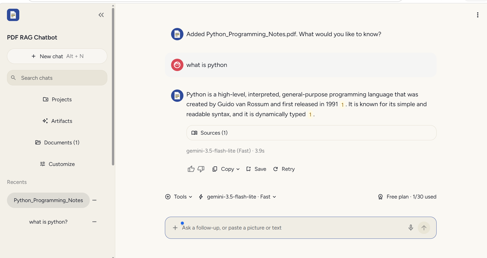
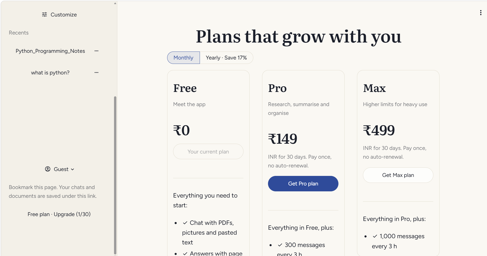
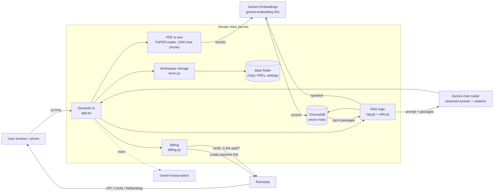
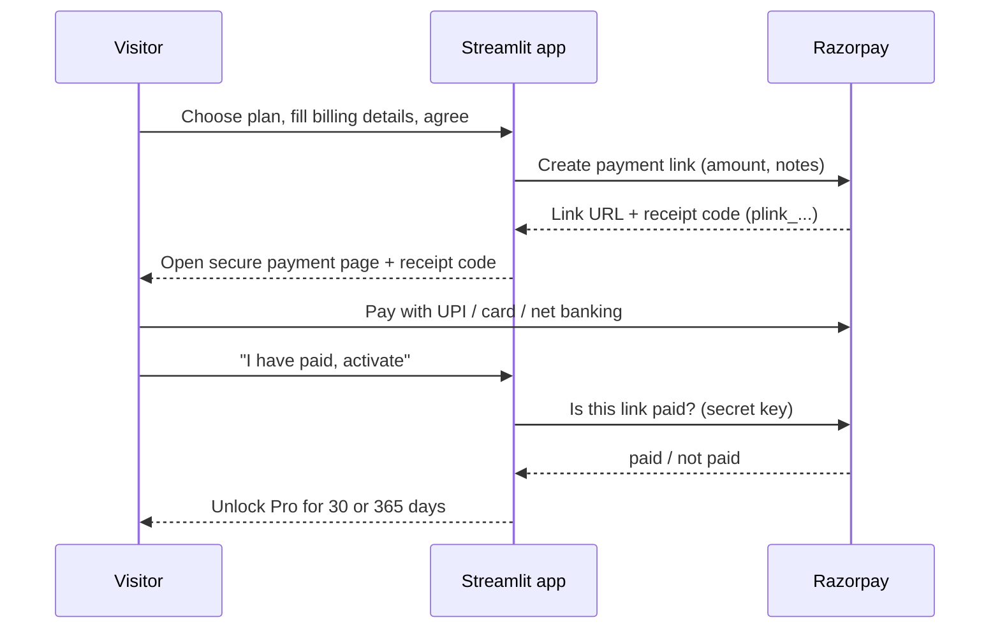

<div align="center">

# 📚 PDF RAG Chatbot

**Chat with your PDFs in a ChatGPT / Claude style interface, with streaming answers and page-level citations.**


**[🌐 Live Demo](https://pdf-rag-chatbot-ipkl.onrender.com/)** · **[🏗 Architecture](#-system-architecture)** · **[🚀 Setup](#-installation-and-setup)** · **[💳 Payments](PAYMENTS.md)**

</div>

## 🌐 Live Demo

**👉 [https://pdf-rag-chatbot-ipkl.onrender.com](https://pdf-rag-chatbot-ipkl.onrender.com/)**

> The live demo runs on a free tier. If it has been idle, the first load can take around a minute. The free Gemini API also has daily limits, so if you see a quota message, try again later.

---

## 📑 Table of Contents

1. [Live Demo](#-live-demo)
2. [About the Project](#-about-the-project)
3. [Screenshots](#-screenshots)
4. [Features](#-features)
5. [System Architecture](#-system-architecture)
6. [How RAG Works Here](#-how-rag-works-here)
7. [Tech Stack](#-tech-stack)
8. [Project Structure](#-project-structure)
9. [Installation and Setup](#-installation-and-setup)
10. [Configuration](#-configuration)
11. [Premium Plans and Payments](#-premium-plans-and-payments)
12. [Deployment (Render)](#-deployment-render)
13. [Testing](#-testing)
14. [Security and Privacy](#-security-and-privacy)
15. [Design Decisions](#-design-decisions)
16. [Limitations](#-limitations)
17. [Roadmap](#-roadmap)
18. [Author](#-author)

---

## 🎯 About the Project

Reading long PDFs (notes, papers, manuals) to find one answer is slow. This app lets you upload one or more PDFs and ask questions in plain language. It finds the most relevant passages, sends only those to **Google Gemini**, and answers with **numbered citations** pointing to the exact page and text, so you can verify every claim.

It uses **Retrieval-Augmented Generation (RAG)**: instead of asking the model to remember your document, the app retrieves the right passages at question time. This keeps answers grounded in your files and reduces made-up answers.

**What makes it more than a demo:**
- ChatGPT / Claude style UI with saved chats, projects and artifacts
- Citations with page numbers and the matched text
- Free / Pro / Max plans with real **Razorpay** checkout (UPI, cards, net banking)
- Automatic model fallback, quota retry and per-session usage limits
- Unit tests for the core logic

---

## 🖼 Screenshots

### Chat with page citations



### Plans page (Free / Pro / Max)



### Home screen


---

## ✨ Features

### 💬 Chat experience
- **Everything is saved**: chats, uploaded PDFs, projects, artifacts, settings and the search index are there the next time you open the app
- Claude-style sidebar: **New chat**, **Search chats**, **Projects**, **Artifacts**, **Documents**, **Customize**, **Pinned** and **Recents**
- Automatic chat titles; from a chat's **⋯** menu you can **rename, pin, add to a project, share, export or delete**
- **Projects**: a named workspace with its own instructions and documents; every chat inside uses them
- **Streaming answers** with a live "searching your documents" step
- Message actions: 👍 / 👎, **Copy**, **Save** to Artifacts, **Retry**
- **Share chat**: export as a self-contained web page or Markdown; download all chats as a zip
- **Paste or drop pictures and text**: press `Ctrl + V` with a screenshot or long text (up to 4 pictures, 8 MB each)
- **Voice dictation**: speak, review the transcript, send (Gemini transcribes)
- **Settings**, **Help** and **About** dialogs, light and dark theme, `Alt + N` for a new chat
- Several **answer languages** (English, Hindi, Marathi, Gujarati, Tamil, Telugu, Bengali, Spanish, French, German) and **Custom instructions**

### 📄 Document intelligence
- **Multiple PDFs**: add once, reuse in any chat, choose which documents each chat can see
- **Citations**: markers like `[1]` link to a **Sources** panel with the exact page and passage
- **Quick actions**: Summarize, Key points, Study notes, Quiz me, FAQ (these read evenly across the whole document)
- **Smart follow-ups**: rewrites "what about its cost?" into a standalone search query
- **Answer style**: Concise / Balanced / Detailed
- **Documents-only mode** (on by default): the assistant says when something is not in your PDFs. Turn it off to allow clearly labelled general knowledge
- Duplicate uploads are detected and not re-embedded
- **Model fallback** across `GEMINI_MODELS` and **embedding retry** on quota errors

### 💳 Plans and payments
- **Free / Pro / Max** plans, monthly or yearly ("Save 17%")
- **Configure your plan** checkout with billing details, order summary and optional GST
- Paid through **Razorpay**: UPI (PhonePe, Google Pay, Paytm), cards and net banking
- Or bring **your own Gemini API key** for no limit

---

## 🏗 System Architecture



### Components

| Component | File | Responsibility |
|---|---|---|
| **UI layer** | `app.py` | Streamlit pages: sidebar, chat, documents, artifacts, plans, checkout, dialogs |
| **RAG core** | `rag.py` | PDF loading, chunking, vector library (Chroma), retrieval, Gemini calls, transcription |
| **Helpers** | `utils.py` | Prompt building, citations, chat titles, export, language rules (pure functions, unit tested) |
| **Billing** | `billing.py` | Creates Razorpay payment links and verifies payment status |
| **Storage** | `store.py` | Saves and loads chats, PDFs and settings on disk per workspace |
| **Styling** | `styles.py`, `.streamlit/config.toml` | Theme, fonts, small CSS tweaks |

### Payment flow



The app never sees card or UPI details. The visitor pays on Razorpay's own page.

---

## 🧠 How RAG Works Here

```
Add PDF  ->  pages  ->  1000-char chunks (200 overlap)  ->  Gemini embeddings  ->  ChromaDB (tagged by document)

Question ->  (rewrite follow-up)  ->  top-k chunks from the chat's documents
         ->  prompt with numbered excerpts + recent chat  ->  Gemini streams the answer
         ->  citations [1] [2]  ->  Sources with page and passage
```

1. **Index once.** Each PDF is read page by page (`PyPDFLoader`), split with `RecursiveCharacterTextSplitter` (default 1000 characters, 200 overlap), embedded with `gemini-embedding-001` and stored in ChromaDB with `doc_id`, file name and page number.
2. **Retrieve.** For a question, the app searches only the documents attached to the current chat and returns the top-k passages (default 4). For *Summarize / Quiz / Notes* it instead samples chunks evenly across the whole document.
3. **Generate.** The prompt contains numbered excerpts, the last few messages and the question. Gemini streams an answer and cites excerpt numbers.
4. **Show.** Citation numbers become badges; the **Sources** panel shows file, page and the matched text.

**Why "Answer from my documents only" can say "I could not find the answer":** in this mode the model is told to reply with that exact sentence if the retrieved excerpts do not contain the answer. Ask specific questions (for example, "What is Generative AI according to GenAI Notes?") or turn the setting off in **Settings → Answers** to allow labelled general knowledge.

---

## 🛠 Tech Stack

| Layer | Technology |
|---|---|
| Language | Python 3.11 |
| UI | Streamlit 1.65+ (native chat, status, dialog, popover components) |
| PDF loading | LangChain `PyPDFLoader` (`pypdf`) |
| Splitting | `RecursiveCharacterTextSplitter` |
| Embeddings | Google Gemini `gemini-embedding-001` |
| Vector DB | ChromaDB via `langchain-chroma` (saved on disk in the workspace data folder) |
| Generation | Google Gemini chat models (`langchain-google-genai`) |
| Payments | Razorpay payment links (UPI, cards, net banking) |
| Config | `python-dotenv` |
| Hosting | Render |

---

## 📁 Project Structure

```
PDF-RAG-chatbot/
├── app.py                  # Streamlit UI: sidebar, chat, documents, artifacts, plans, dialogs
├── rag.py                  # RAG core: PDF loading, vector library, retrieval, Gemini calls
├── utils.py                # Pure helpers: prompts, citations, titles, export (unit tested)
├── billing.py              # Razorpay payment links for Premium
├── store.py                # Saves and loads chats, PDFs and settings on disk
├── PAYMENTS.md             # How to set up and test payments
├── DEMO_GUIDE.md           # How it works, how to demo it, interview Q&A
├── styles.py               # A few lines of CSS (theme itself is in config.toml)
├── assets/                 # logo.svg, logo.png, favicon.png
├── .streamlit/config.toml  # Light + dark theme, fonts
├── tests/                  # Unit tests: test_utils.py, test_billing.py, test_store.py
├── requirements.txt
├── .env.example            # Template for your environment variables
└── README.md
```

---

## 🚀 Installation and Setup

**Prerequisites:** Python 3.10+ and a free Gemini API key from [Google AI Studio](https://aistudio.google.com/apikey).

```bash
git clone https://github.com/kalevaishnavi04/PDF-RAG-chatbot.git
cd PDF-RAG-chatbot
python -m venv venv

# Windows
venv\Scripts\activate
# Mac / Linux
source venv/bin/activate

pip install -r requirements.txt

# Windows
copy .env.example .env
# Mac / Linux
cp .env.example .env
```

Open `.env` and add your key:

```env
GOOGLE_API_KEY=your_api_key_here
GEMINI_MODELS=gemini-3.8-flash
```

Run the app:

```bash
streamlit run app.py
```

Open `http://localhost:8501`.

> **Tip (Windows):** if `python` or `streamlit` is not recognised, call the virtual environment directly: `venv\Scripts\python.exe -m streamlit run app.py`.

---

## ⚙️ Configuration

Set these in `.env` (local) or in your host's environment variables (Render). Never commit `.env`.

| Variable | Required | Description |
|---|---|---|
| `GOOGLE_API_KEY` | Yes | Your Gemini API key |
| `GEMINI_MODELS` | No | Comma-separated chat models to try in order, for example `gemini-3.5-flash-lite,gemini-3.8-flash` |
| `FREE_MESSAGE_LIMIT` | No | Free messages per visitor session (default 30) |
| `LIMIT_WINDOW_MIN` | No | Length of the limit window in minutes (default 180) |
| `RAZORPAY_KEY_ID`, `RAZORPAY_KEY_SECRET` | No | Turn on paid plans (start with `rzp_test_` keys) |
| `PREMIUM_PRICE_INR`, `PREMIUM_YEARLY_INR`, `PREMIUM_MESSAGE_LIMIT` | No | Pro monthly price (149), yearly price (1490) and messages per window (300) |
| `MAX_PRICE_INR`, `MAX_YEARLY_INR`, `MAX_MESSAGE_LIMIT` | No | Max plan: 499, 4990 and 1000 |
| `PREMIUM_DAYS`, `GST_RATE` | No | Days in a monthly plan (30); GST percent already inside the prices (0 = no tax line) |
| `DATA_DIR` | No | Folder where everything is saved (default: `data/` next to `app.py`) |
| `WORKSPACE_MODE` | No | `single` (one workspace, default locally) or `per_link` (a private link per visitor, default on Render) |

Rules for the `.env` file: one `NAME=value` per line, **no spaces around `=`, no quotes**, and no stray characters (such as a typographic dash `–`) at the end of a value.

Chunk size, overlap, passages per question, model, answer style and more are in the in-app **Settings**.

---

## 💳 Premium Plans and Payments

| Plan | Price (default) | Messages per window |
|---|---|---|
| Free | ₹0 | 30 |
| Pro | ₹149 / month, ₹1,490 / year | 300 |
| Max | ₹499 / month, ₹4,990 / year | 1,000 |

- One payment buys one period (30 or 365 days). There is **no automatic renewal**, and the checkout says so.
- Billing details (name, email, address, business name, GST number) are saved as notes on the Razorpay payment.
- Use **Test Mode** keys (`rzp_test_...`) for demos: the full flow works and nobody is charged.
- UPI (PhonePe, Google Pay) and QR need your Razorpay account to be activated (KYC). Cards work in Test Mode.

Full setup, test cards and go-live checklist: **[PAYMENTS.md](PAYMENTS.md)**.

---

## ☁️ Deployment (Render)

| Setting | Value |
|---|---|
| Service type | Web Service |
| Build command | `pip install -r requirements.txt` |
| Start command | `streamlit run app.py --server.port $PORT --server.address 0.0.0.0` |
| Environment variables | `GOOGLE_API_KEY`, `PYTHON_VERSION=3.11.9` |
| Optional variables | `GEMINI_MODELS`, `RAZORPAY_KEY_ID`, `RAZORPAY_KEY_SECRET`, plan prices |

Steps:
1. Push this repo to GitHub (make sure `.env` is **not** committed; it is in `.gitignore`).
2. On [render.com](https://render.com): **New → Web Service**, connect the repo.
3. Enter the build and start commands above.
4. Add the environment variables under **Environment**. Keep keys here, never in git.
5. Deploy. Every `git push` to `main` redeploys automatically.

---

## 🧪 Testing

```bash
python -m pytest -q
```

Or run files directly: `python tests/test_utils.py`, `python tests/test_billing.py`, `python tests/test_store.py`.

Tests cover prompt building, citations, plan and billing logic, and workspace storage.

---

## 🔒 Security and Privacy

- API keys and Razorpay secrets live in **environment variables** and are never committed (`.env` is git-ignored)
- The prompt tells the model to **ignore instructions hidden inside PDFs** (prompt-injection defence)
- Card and UPI details never touch this app: payment happens on Razorpay's page
- Premium is unlocked only after the app asks Razorpay with the secret key whether the payment link is **paid**
- Uploaded data is stored as plain files (not encrypted), so do not upload highly sensitive documents to a shared deployment

---

## 🧩 Design Decisions

| Decision | Why |
|---|---|
| **RAG instead of long context** | Cheaper, faster and gives page-level citations that can be checked |
| **1000-char chunks with 200 overlap** | Keeps sentences together and avoids losing facts at chunk borders |
| **Tag chunks with `doc_id`** | One vector store serves many documents; each chat searches only its own |
| **Even sampling for Summarize / Quiz** | Similarity search finds specific facts; summaries need coverage of the whole document |
| **Smart follow-up rewriting** | "What about its cost?" is useless to a vector search until it is made standalone |
| **Model fallback + embedding retry** | Free-tier quotas fail often; the app degrades gracefully instead of crashing |
| **Razorpay payment links** | No card data handled by the app, and UPI is supported for Indian users |
| **Documents-only toggle** | Lets the user choose between strict grounding and general-knowledge answers |

---

## ⚠️ Limitations

- Text-based PDFs only (no OCR for scanned pages)
- Data is saved as plain files in `data/`. Two browser tabs on the same workspace can overwrite each other's latest changes
- On Render's free tier the disk is wiped when the service restarts or redeploys, so saved data does not survive there. Attach a persistent disk and set `DATA_DIR` to its path, or move to a database
- Free Gemini tier has daily limits. The in-app message limit is per browser session (a refresh resets it), so it is a courtesy meter, not strict enforcement
- **No user accounts**: the Premium receipt code is the licence, so it can be shared. There is no log out
- No automatic renewal, refunds or webhooks inside the app (use the Razorpay dashboard)
- Share produces files, not live links
- Pictures are used for the question and follow-ups but are not added to the document library
- Voice uses the browser's default microphone and needs HTTPS or localhost

---

## 🔮 Roadmap

- [ ] Google login with `st.login` and per-user accounts
- [ ] Database (SQLite / Postgres) and persistent vector store
- [ ] Razorpay webhooks so Premium activates by itself, and Subscriptions for renewal
- [ ] OCR for scanned PDFs, DOCX and TXT support
- [ ] Re-ranking of retrieved passages and an evaluation set for answer quality
- [ ] Read-aloud answers
- [ ] Installable mobile app (PWA, then a native client over a FastAPI backend)

---

## 👩‍💻 Author

**Vaishnavi Kale**
Python Developer | B.E. Information Technology (Honours in Data Science)

[](https://github.com/kalevaishnavi04)

If this project helped you, consider giving it a ⭐ on GitHub.
